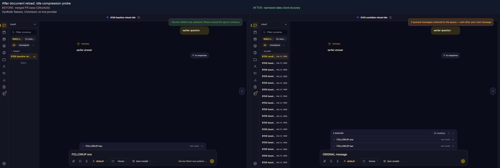
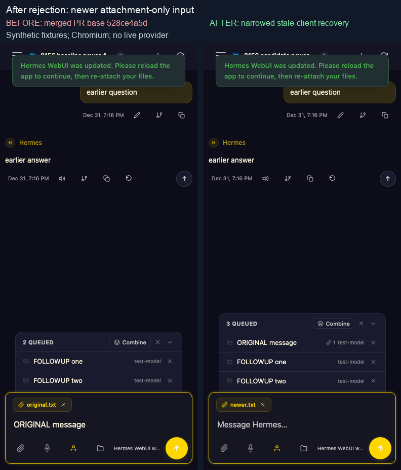
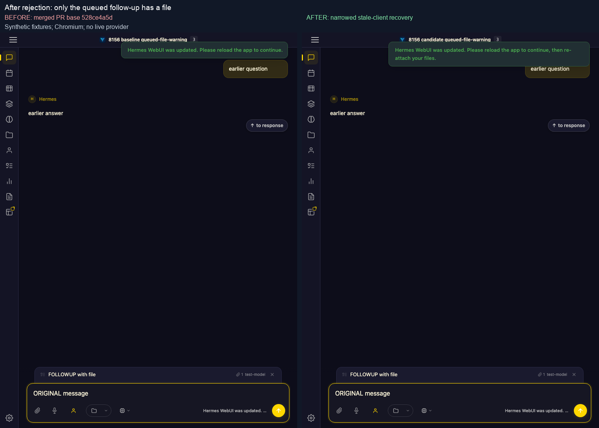

# Stale-client recovery: browser regression evidence

Before/after evidence for PR #8156. **Before** is the reviewed PR merged with upstream at `528ce4a5dccd27766418fe53bf325777d34b9769`; **after** adds the narrowed stale-client recovery fixes. Each pair contains unaltered application screenshots, with comparison labels added above them.

## Verification scope

- Real Chromium page, production JavaScript, native file inputs/uploads, `loadSession`, document reload, browser storage and server draft readback.
- Seven schedules at desktop (1440×900), narrow (768×1024), and mobile-touch emulation (390×844): **21 candidate cases passed; all 21 baseline controls reproduced a failure**.
- The schedules are reload with idle compression status, reload with an HTTP-503 compression-status probe, newer attachment-only input while chat start is pending, an attachment-free original with a file on its queued follow-up, rejection while the visible session is null with a newer native File staged, and reload with initial compression-status HTTP 403 or 429 errors. The 403/429 cases also verify no synthetic compression lock and that a subsequent native Send reaches chat start.
- **360 actual JavaScript response hashes** matched the selected baseline/candidate assets, including `/session/static/` requests after navigation. Zero uncaught page exceptions or setup errors.
- Stale starts reached the real server's typed rejection. Compression statuses were controlled fixtures. The null-owner case directly sets the cleared-session await boundary; it does not certify a complete deletion workflow. It verifies that the ownerless newer File stays untouched while the original text and file metadata are read back under the rejected owner from the real draft API. All sessions and files were synthetic, with isolated state and no live provider execution.

## Reload does not dispatch queued follow-ups

After rejecting the original message and queuing two follow-ups, reload the document. The candidate retains `ORIGINAL message` in the composer and both follow-ups in the queue, with no additional chat start. The baseline idle status probe starts draining the queue over the recovered draft.

## Newer attachment-only input stays in the composer

While the original start is pending, stage `newer.txt` without typing more text, then release the stale rejection. The candidate leaves that native File in the composer and places the original message, with its original file, before the queued follow-ups. The baseline replaces the newer file with the rejected original.

## Queued files receive the reattachment warning

Send an attachment-free original and queue a follow-up with a file while its start is held. The candidate warning explicitly says to reattach files after reload; the baseline warning omits that instruction.

## Limits

These are functional regression comparisons, not a full visual redesign or PWA-cache certification. Toasts are captured while visible; the existing truncated composer-status cue is not claimed repaired. The sidebar can contain other synthetic fixture sessions from the matrix. Mobile behavior uses Chromium touch emulation, not physical hardware; CDN resources and service workers were blocked. File bytes remain in memory only and are not claimed durable across reload.

Only stale-client rejection opts into the newer-file protection. Ordinary-error and compression-rotation recovery retain their previous behavior; the older compression attachment conflict is explicitly not fixed by this PR.
